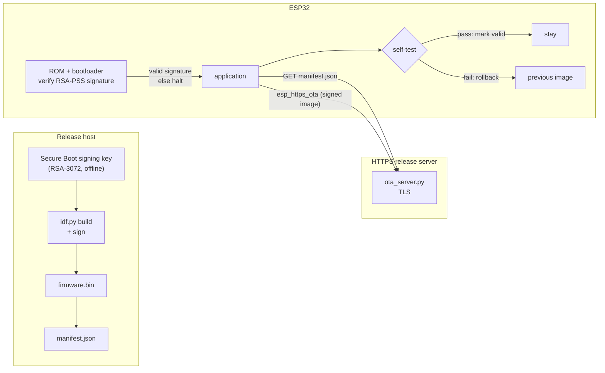

# ESP32 Secure OTA

A production-shaped, end-to-end firmware update pipeline for the classic
ESP32: **Secure Boot v2**, **AES-256 flash encryption**, **signed HTTPS OTA**,
**anti-rollback**, and **automatic rollback on a failed self-test** — with a
reproducible release tooling flow and host tests that run in CI.

Most student IoT repos flash firmware over a serial cable and call it a day.
This one answers the question an embedded security team actually asks: *how do
you get new, trusted code onto a fielded device without a cable — and how do
you recover when that code is bad?*

## What it demonstrates

- **Secure Boot v2** (RSA-3072 / RSA-PSS): only firmware signed with your key
  runs; the public-key digest is burned into eFuse.
- **Flash encryption** (AES-256): flash readout does not disclose plaintext.
- **Signed HTTPS OTA**: `esp_https_ota` against a server whose certificate the
  device validates against an embedded CA.
- **Version-gated rollout**: the device only updates when the release manifest
  advertises a newer version.
- **Anti-rollback + rollback**: a bad update is rejected by the bootloader or
  reverted automatically after a self-test fails.
- **Reproducible releases**: `tools/build_release.sh` signs the image and emits
  a manifest with size + SHA-256.

## Architecture



## Repository layout

```
esp32-secure-ota/
├── CMakeLists.txt              # project + version sourcing
├── partitions.csv              # two OTA slots + otadata (no factory partition)
├── sdkconfig.defaults          # safe defaults: builds on any ESP32, no eFuse burned
├── sdkconfig.secure.defaults   # opt-in Secure Boot v2 + flash encryption + anti-rollback
├── version.txt                 # current app version (drives the manifest)
├── main/
│   ├── app_main.c              # boot, self-test/confirm, Wi-Fi, OTA check
│   ├── ota_client.c/.h         # manifest fetch, version compare, signed OTA
│   ├── wifi.c/.h               # station bring-up with retry budget
│   ├── Kconfig.projbuild       # OTA URL, Wi-Fi credentials, rollback-test switch
│   └── certs/server_ca.pem     # embedded TLS trust anchor (TEST CA by default)
├── tools/
│   ├── gen_keys.sh             # generate the RSA-3072 signing key
│   ├── build_release.sh        # signed build -> release/firmware.bin + manifest.json
│   ├── manifest.py             # manifest build/verify helpers
│   ├── ota_server.py           # local HTTPS release server
│   └── test-pki/               # TEST-ONLY CA + localhost server cert
├── tests/                      # host tests (manifest, PKI) run in CI
└── docs/                       # threat model, Secure Boot notes
```

## Requirements

- ESP-IDF **v5.2+** (`idf.py` on `PATH`)
- A classic **ESP32** dev board (Secure Boot v2 needs chip revision **v3.0+**)
- `openssl`, `python3`
- `pytest` + `cryptography` for the host tests

### Will Secure Boot v2 run on my board?

Secure Boot v2 requires **ESP32 chip revision v3.0 (ECO3) or newer**. Check with:

```bash
esptool.py chip_id        # look at "Chip is ESP32 ... (revision vX.Y)"
```

- **revision >= v3.0** → Secure Boot v2 (this repo's secure config).
- **older silicon** → use **Secure Boot v1** instead; the OTA, manifest and
  rollback parts of this project are unchanged. See `docs/secure-boot-esp32.md`.

> Classic ESP32 flash encryption is AES-256. There is no AES-XTS on this chip.

## Quick start (safe, no eFuse burned)

```bash
# 1. Configure Wi-Fi + manifest URL
idf.py menuconfig     # Secure OTA configuration

# 2. Build and flash the normal (unsigned) firmware
idf.py build flash monitor
```

This path leaves Secure Boot / flash encryption off, so it cannot brick the
board. Use it to bring up Wi-Fi and the OTA client first.

## Enabling Secure Boot v2 + flash encryption

> **Irreversible.** The first boot burns eFuses. Read
> `docs/secure-boot-esp32.md` before doing this.

```bash
# 1. Generate the signing key ONCE and keep it offline
./tools/gen_keys.sh

# 2. Build with the secure configuration
idf.py -D SDKCONFIG_DEFAULTS="sdkconfig.defaults;sdkconfig.secure.defaults" build

# 3. Flash the bootloader/app and let the first boot provision the device
idf.py flash monitor
```

After provisioning, only images signed with `secure_boot_signing_key.pem`
will boot, and OTA updates are the normal field-update path.

## Running an OTA update end to end

```bash
# Build + sign a release (bump version.txt first so the device sees it as newer)
echo "1.1.0" > version.txt
./tools/build_release.sh

# Serve release/ over HTTPS (TEST PKI by default)
python3 tools/ota_server.py --dir release --port 8443
```

Point `CONFIG_OTA_MANIFEST_URL` at `https://<host>:8443/manifest.json`, reset
the device and watch the log. It should report the new version, download,
validate the signature and reboot into it.

### Testing the rollback path

Build the next image with the self-test forced to fail, then run the same OTA
flow:

```bash
idf.py -D CONFIG_APP_SELF_TEST_FAIL=y build
```

On first boot the new image fails its self-test and the bootloader rolls back
to the previous slot. The default self-test checks the running partition's app
description and an NVS round-trip; it is not a hardware peripheral probe.

## Attack tests

| # | Attack | Expected result | Automated? |
|---|--------|-----------------|------------|
| 1 | Unsigned image written to an OTA slot | Bootloader refuses to boot it | bootloader (hardware) |
| 2 | Image signed with a different key | Signature verification fails | bootloader (hardware) |
| 3 | Manifest advertises a lower version (downgrade) | Device skips the update (anti-rollback also enforces this) | on-device |
| 4 | Tampered manifest / firmware (digest mismatch) | Host `verify_manifest` rejects | **yes** (`tests/test_manifest.py`) |
| 5 | Rogue server certificate | TLS handshake fails (CA not trusted) | on-device + `tests/test_pki.py` |
| 6 | New image crashes before self-test | Bootloader rolls back to previous image | bootloader (hardware); `CONFIG_APP_SELF_TEST_FAIL=y` exercises the failure path |

## Results

Fill these in as the board is exercised — do not publish unmeasured numbers.

| Metric | Method | Value |
|--------|--------|-------|
| Signed app image size | `stat -c%s release/firmware.bin` | _to measure_ |
| OTA download time (LAN) | device log timestamps | _to measure_ |
| OTA flash-write time | device log timestamps | _to measure_ |
| Total update wall time | first log line -> reboot | _to measure_ |
| Rolling-back boot after failed self-test | `otatool.py` + serial log | _to measure_ |
| Secure boot added boot time | boot log delta (secure vs insecure) | _to measure_ |
| Heap at idle after OTA check | `esp_get_free_heap_size()` | _to measure_ |

## Tests

```bash
pip install -r tests/requirements.txt
pytest tests -q
```

Covers manifest generation/verification, tamper detection, version ordering and
the test PKI (CA signs the server cert, rogue certs are rejected, embedded CA
matches the test CA).

## Limitations

- The demo Wi-Fi credentials and manifest URL live in Kconfig; a real product
  should provision them at runtime.
- The manifest adds version gating and server-side integrity checking;
  on-device image authenticity comes from Secure Boot, not the manifest.
- The committed CA and keys under `tools/test-pki/` are **test-only**.
- The secure config uses flash-encryption *development* mode so you can keep
  re-flashing; flip to release mode only once you commit to a device lifecycle.
- No power-loss mid-OTA recovery test is automated yet.

## Roadmap

- Signed data-partition updates (`CONFIG_APP_UPDATE_SECURE_SIGNED_DATA_PARTITION`).
- A/B rollout with a percent-gated manifest and server-side telemetry.
- Rollback test in CI using QEMU once the target supports it.

## License

MIT — see `LICENSE`.
